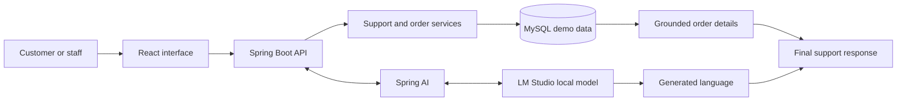

<div align="center">


# SMART-CUSTOMER-SUPPORT-SYSTEM

<p>


</p>

**One workspace. Five support views. Local-first AI.**

<a href="#01--take-the-tour">Take the tour</a> &nbsp;·&nbsp;
<a href="#02--how-a-question-travels">How it works</a> &nbsp;·&nbsp;
<a href="#03--launch-it-on-your-laptop">Run it</a> &nbsp;·&nbsp;
<a href="#04--when-something-breaks">Troubleshooting</a>

</div>

---

## 01 / Take the tour

<p align="center">
  
</p>

<p align="center"><sub>The visual tour is a looping vector recreation of the five page layouts. It is deliberately rendered as SVG to keep UI labels and panels sharp instead of enlarging a low-resolution GIF.</sub></p>

This project brings customer questions and support operations into one interface. The React frontend talks to a Java/Spring Boot API, which reads demo order data from MySQL and connects to a locally hosted language model through LM Studio.

> **Project boundary:** This is a learning and portfolio demo. It does not connect to a live shop, submit real return requests, issue refunds, send customer emails, or automatically cancel orders.

### The five stops

<table>
<tr>
<td width="50%" valign="top">

**01 · Overview**

A dashboard-style landing view for a quick look at demo order activity and support entry points.

</td>
<td width="50%" valign="top">

**02 · AI Support**

A chat interface that combines a local model with backend order lookup and return-policy handling.

</td>
</tr>
<tr>
<td width="50%" valign="top">

**03 · Orders**

Search, inspect, create, and update demo orders, including status and estimated delivery information.

</td>
<td width="50%" valign="top">

**04 · Policies**

A focused place to read the demo return/refund guidance used by the support flow.

</td>
</tr>
<tr>
<td colspan="2" valign="top">

**05 · Automation**

A scheduled scan checks for overdue orders that remain `PROCESSING` or `SHIPPED`, creates internal alerts, stores run history, and lets staff run a check or acknowledge an alert.

</td>
</tr>
</table>

---

## 02 / How a question travels

This is the basic request path from browser to answer:



The AI is one part of the system, not the whole system. Java handles application rules and database access; MySQL stores the demo records; Spring AI connects the backend to the local model. Return-policy questions also have a deterministic backend path, because business-critical guidance should not depend entirely on a small model guessing what to do.

### What the system can and cannot do

- **Can:** answer general support questions, look up demo order information, show policy guidance, manage demo orders, detect overdue delivery dates, and record internal automation alerts.
- **Does not yet:** sync a real commerce store, email customers, execute returns/refunds, assign a live human-agent ticket queue, or run production-grade access control.

---

## 03 / The build recipe

The stack is split by responsibility rather than by marketing label.

<details open>
<summary><strong>Backend and business rules</strong></summary>

- **Java 21** for the application code.
- **Spring Boot 3.4.5** for REST endpoints and application runtime.
- **Spring AI 1.0.0** for model integration.
- **Spring Data JPA + Hibernate** for persistence mapping.
- **Spring Boot Validation and Actuator** for validation and health/management endpoints.
- **Maven** for dependency management, tests, and execution.
</details>

<details>
<summary><strong>AI and data</strong></summary>

- **LM Studio** serves a local model through an OpenAI-compatible API, normally at `http://localhost:1234/v1`.
- **MySQL 8.x** stores orders and automation records.
- **A small instruct/chat model** is recommended for low-memory laptops; model speed and answer quality depend on hardware and model choice.
- A paid OpenAI API key is not required for the configured local workflow.
</details>

<details>
<summary><strong>Frontend and developer tools</strong></summary>

- **React 18 + TypeScript 5.7** build the interface.
- **Vite 6 + npm** run and bundle the frontend.
- **lucide-react** supplies icons.
- **Git + GitHub** support version control; **VS Code or another Java IDE** can be used for editing and debugging.
</details>

---

## 04 / Launch it on your laptop

Follow the sequence in order. Start MySQL and LM Studio before testing a full chat flow.

### Station A · Install the prerequisites

| Install | Recommended version | Check it in a terminal |
|---|---|---|
| Java JDK | 21 | `java -version` |
| Apache Maven | 3.9+ | `mvn -version` |
| Node.js + npm | Node.js LTS, Node 20+ recommended | `node -v` and `npm -v` |
| MySQL Server | 8.x | `mysql --version` |
| LM Studio | Desktop app for your OS | Open the application |
| Git | Optional, useful for cloning | `git --version` |

Supported setup examples in this guide use Windows PowerShell. Equivalent commands can be run in a macOS/Linux shell with environment-variable syntax adjusted.

**Low-memory laptop tip:** choose a small quantized model compatible with your available RAM. You do not need a large model merely to run the Java backend or frontend.

### Station B · Get the code

```powershell
git clone https://github.com/SAI-SRINIVAS-P/SMART-CUSTOMER-SUPPORT-SYSTEM.git
cd SMART-CUSTOMER-SUPPORT-SYSTEM
```

Prefer not to use Git? Open the repository on GitHub, choose **Code → Download ZIP**, then extract it.

### Station C · Prepare MySQL

In MySQL Workbench or a MySQL command-line session with administrator permissions, run:

```sql
CREATE DATABASE IF NOT EXISTS smartsupport;

CREATE USER IF NOT EXISTS 'smartsupport'@'localhost'
  IDENTIFIED BY 'replace-with-a-strong-local-password';

GRANT ALL PRIVILEGES ON smartsupport.* TO 'smartsupport'@'localhost';
FLUSH PRIVILEGES;
```

If the account already exists, use `ALTER USER` to reset its password. Keep the real password local and never commit it to GitHub.

### Station D · Set local environment values

In the **same PowerShell window** you will use for the backend:

```powershell
$env:DB_USERNAME = "smartsupport"
$env:DB_PASSWORD = "replace-with-a-strong-local-password"
$env:LM_STUDIO_BASE_URL = "http://localhost:1234/v1"
$env:LM_STUDIO_API_KEY = "lm-studio"
$env:LM_STUDIO_MODEL = "local-model"
```

The LM Studio API key value above is a local placeholder, not a real OpenAI credential. If chat cannot find the model, set `LM_STUDIO_MODEL` to the model identifier exposed by your LM Studio server.

### Station E · Start the local AI server

1. Open LM Studio and download a model your laptop can run.
2. Load the model into memory.
3. Open the **Developer / Local Server** area. The label can vary by LM Studio version.
4. Start the OpenAI-compatible server at `http://localhost:1234`.
5. Leave LM Studio running while you use AI Support.

### Station F · Start the backend

Open terminal window **#1** from the project root:

```powershell
cd backend
mvn test
mvn spring-boot:run
```

The backend should listen at **http://localhost:8080**.

Useful local endpoints:
- Health: `http://localhost:8080/api/health`
- Orders: `http://localhost:8080/api/orders`
- Policy: `http://localhost:8080/api/policy`

The development configuration uses Hibernate `ddl-auto: update` to create/update tables. The demo seeder inserts sample orders only when the orders table is empty.

### Station G · Start the frontend

Open terminal window **#2** from the project root:

```powershell
cd frontend
npm install
npm run dev
```

Open the local URL printed by Vite, usually **http://localhost:5173**.

For a frontend production build:

```powershell
npm run build
```

### Station H · Run the first smoke test

1. Open **Overview** and check that the backend indicator shows online.
2. Under **AI Support**, ask `Where is order ORD-1001?` and `What is your return policy?`.
3. Under **Orders**, search for `ORD-1001`.
4. Under **Automation**, select **Run check now**.
5. To test an overdue alert, set an order's estimated delivery date to yesterday while leaving the status `SHIPPED` or `PROCESSING`. Run a scan, confirm the alert, run it again to check for duplicates, then restore the original delivery date.

---

## 05 / When something breaks

Expand the closest symptom and work from the first meaningful error in the backend terminal.

<details>
<summary><strong>🔌 Spring Boot cannot connect to MySQL</strong></summary>

- Confirm the MySQL service is running and the `smartsupport` schema exists.
- Check the JDBC URL in `backend/src/main/resources/application.yml`; the development default uses `localhost:3306`.
- Set `DB_USERNAME` and `DB_PASSWORD` in the same PowerShell window used for `mvn spring-boot:run`.
- Restart Spring Boot after changing environment variables.
</details>

<details>
<summary><strong>🔐 MySQL says “Access denied for user 'smartsupport'@'localhost'”</strong></summary>

The account password or privileges do not match. Sign in to MySQL as an administrator and run:

```sql
ALTER USER 'smartsupport'@'localhost'
  IDENTIFIED BY 'replace-with-a-strong-local-password';
GRANT ALL PRIVILEGES ON smartsupport.* TO 'smartsupport'@'localhost';
FLUSH PRIVILEGES;
```

Set `$env:DB_PASSWORD` to the same password and restart the backend.
</details>

<details>
<summary><strong>🧱 MySQL says a table is missing or cannot be created</strong></summary>

- Read the first database error and its `Caused by` section in the backend terminal.
- Confirm the application user has privileges on the `smartsupport` schema, including table creation for this development setup.
- Once permissions are corrected, restart Spring Boot. Hibernate should create/update tables with `ddl-auto: update`.
</details>

<details>
<summary><strong>🛠️ “mvn” or “npm” is not recognized</strong></summary>

Install JDK 21 and Maven, then install Node.js LTS (which includes npm). Close and reopen PowerShell and confirm `java -version`, `mvn -version`, `node -v`, and `npm -v` work.
</details>

<details>
<summary><strong>🌐 Frontend says the backend is offline</strong></summary>

- Confirm Spring Boot started successfully on port 8080.
- Check the backend terminal for startup failures.
- Use the browser developer tools **Network** tab to find failing `/api` requests.
- The frontend API base URL is configured in `frontend/src/App.tsx`; update it if the backend runs on another port.
</details>

<details>
<summary><strong>🧠 AI Support returns an empty answer or cannot reach LM Studio</strong></summary>

- Confirm the model is loaded and the local server is running on port 1234.
- Check `LM_STUDIO_BASE_URL` and `LM_STUDIO_MODEL`.
- Start with a simple prompt such as `Where is order ORD-1001?`.
- Small models can struggle with complex instructions. Common return-policy questions have a deterministic backend path; general replies still depend on the local model.
</details>

<details>
<summary><strong>⚙️ Automation page cannot load</strong></summary>

- Confirm the automation backend classes are present in your local copy.
- Restart Spring Boot and check its startup output.
- Check the browser Network tab for `/api/automation/...` failures.
- Verify MySQL is reachable and inspect the first backend exception.
</details>

<details>
<summary><strong>🚦 Port 8080 or 5173 is already in use</strong></summary>

Stop the other process using the port or configure a different port. If the backend port changes, also update the frontend API base URL in `frontend/src/App.tsx`.
</details>

If the problem survives these checks, keep the **first meaningful exception and its “Caused by” section** when asking for help. Never attach real passwords, API keys, or other secrets.

---

## 06 / Settings card

| Variable | Default | Why you might change it |
|---|---|---|
| `DB_USERNAME` | `smartsupport` | MySQL application account |
| `DB_PASSWORD` | `change-this-password` | Set your own local account password |
| `LM_STUDIO_BASE_URL` | `http://localhost:1234/v1` | Address of the local model server |
| `LM_STUDIO_API_KEY` | `lm-studio` | Local compatibility placeholder |
| `LM_STUDIO_MODEL` | `local-model` | Model identifier exposed by LM Studio |
| `AUTOMATION_ENABLED` | `true` | Enable or disable scheduled scans |
| `AUTOMATION_SCAN_INTERVAL_MS` | `300000` | Scan interval, in milliseconds |
| `AUTOMATION_INITIAL_DELAY_MS` | `30000` | Delay before the first scan, in milliseconds |

---

## 07 / Project map

```text
SMART-CUSTOMER-SUPPORT-SYSTEM/
├── backend/
│   ├── src/main/java/com/example/smartsupport/
│   │   ├── automation/     scheduled scans, alerts, run history
│   │   ├── chat/           chat flow, policy answers, model tools
│   │   ├── order/          order API and persistence
│   │   ├── seed/           demo order data
│   │   └── config/         web configuration
│   ├── src/main/resources/application.yml
│   └── pom.xml
├── frontend/
│   ├── src/App.tsx
│   ├── src/style.css
│   └── package.json
└── docs/
    ├── animated-title.svg
    └── project-tour.svg
```

## 08 / Before calling it production-ready

This repository is intended for learning and portfolio demonstration. Before using it with real customers, add and validate authentication and authorization, secure secret management, database migrations, deployment configuration, monitoring, backups, and an auditable approval flow for sensitive actions.

Returns and refunds are **guidance only** in this version. Delivery automation creates internal notifications; it does not send emails or SMS and does not change order status automatically.

---

<div align="center">

**Built to make the support path clearer.**

<sub>Explore the code, run it locally, test the workflows, and improve it one well-understood feature at a time.</sub>

</div>
