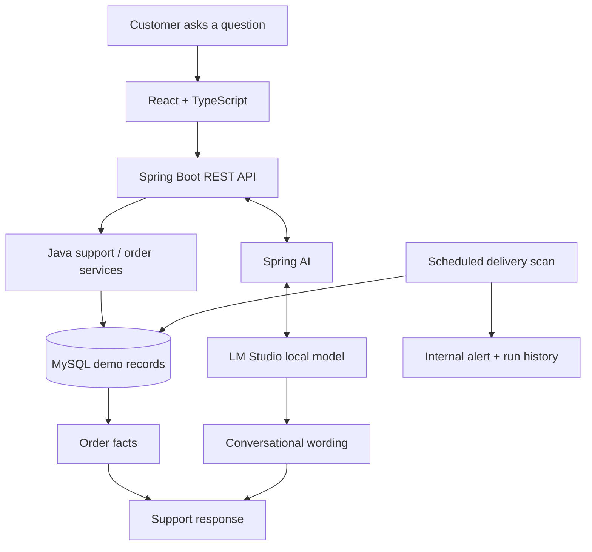

<div align="center">



<p align="center">
  
</p>
</div>

<table>
<tr>
<td width="33%" valign="top">

<sub>INPUT</sub>

### Customer question

“Where is my order?”

</td>
<td width="33%" valign="top">

<sub>PROCESS</sub>

### Application logic

Java services + MySQL data + local model

</td>
<td width="34%" valign="top">

<sub>OUTPUT</sub>

### Support response

Order-aware guidance and internal alerts

</td>
</tr>
</table>

<div align="center">

**A practical support-workflow project, not just a chat window.**

<strong>SCREEN ATLAS</strong> &nbsp; ◇ &nbsp;
<strong>TRACE A REQUEST</strong> &nbsp; ◇ &nbsp;
<strong>BOOT SEQUENCE</strong> &nbsp; ◇ &nbsp;
<strong>INCIDENT LOG</strong>

</div>

---

## The screen atlas

<p align="center">
  
</p>

<sub>Five views, one workflow. The looping vector tour is designed to stay sharp in GitHub's README renderer.</sub>

| VIEW / 01 | VIEW / 02 | VIEW / 03 | VIEW / 04 | VIEW / 05 |
|---|---|---|---|---|
| **Overview** | **AI Support** | **Orders** | **Policies** | **Automation** |
| Order activity and entry points | Chat + backend lookup | Search and edit demo orders | Return/refund policy guidance | Overdue-order alerts and scan history |

---

## Trace a request

The system has a clear division of responsibility:



### The capability ledger

<details open>
<summary><strong>Signals handled by this version</strong></summary>

- Order questions can retrieve information from the demo database.
- Return-policy questions have a direct backend handling path instead of depending only on model interpretation.
- Staff can search, create, and update demo order records through the Orders view.
- Scheduled automation detects past estimated delivery dates for orders still marked `PROCESSING` or `SHIPPED`.
- Automation records internal notifications and run history, allows a manual scan, and lets staff acknowledge alerts.
</details>

<details>
<summary><strong>Signals this version does not perform</strong></summary>

This project does **not** sync with a live shop, send customer email/SMS, submit or approve returns, issue refunds, cancel orders automatically, or provide production-grade authentication/authorization. The database and policy are demonstration data.
</details>

---

## Hardware + software checkpoint

Think of this as the equipment list before starting the shift.

| Component | Install | Quick check |
|---|---|---|
| Java Development Kit | **JDK 21** | `java -version` |
| Maven | **3.9+** | `mvn -version` |
| Node.js + npm | **Node.js LTS**, Node 20+ recommended | `node -v` · `npm -v` |
| Database | **MySQL 8.x** | `mysql --version` |
| Local model server | **LM Studio** + a compatible instruct/chat model | Load model and start server |
| Git | Recommended for cloning | `git --version` |

The commands below use **Windows PowerShell**. The project can be edited on other operating systems, but shell variable syntax will differ.

**Low-memory laptop:** choose a small quantized model that fits your available RAM. The Java backend and React frontend do not require a large model just to start. The configured local workflow does not need a paid OpenAI API key.

---

## Boot sequence

### 00 / Bring the repository into the workspace

```powershell
git clone https://github.com/SAI-SRINIVAS-P/SMART-CUSTOMER-SUPPORT-SYSTEM.git
cd SMART-CUSTOMER-SUPPORT-SYSTEM
```

Alternatively, use GitHub's **Code → Download ZIP** option and extract the archive.

### 01 / Give MySQL a local database

Open MySQL Workbench or a MySQL command-line session with administrator permissions:

```sql
CREATE DATABASE IF NOT EXISTS smartsupport;

CREATE USER IF NOT EXISTS 'smartsupport'@'localhost'
  IDENTIFIED BY 'replace-with-a-strong-local-password';

GRANT ALL PRIVILEGES ON smartsupport.* TO 'smartsupport'@'localhost';
FLUSH PRIVILEGES;
```

If that account already exists, use `ALTER USER` to reset its password. Keep real credentials on your laptop, not in Git.

### 02 / Point Spring Boot at local services

In the **PowerShell window used for the backend**, set:

```powershell
$env:DB_USERNAME = "smartsupport"
$env:DB_PASSWORD = "replace-with-a-strong-local-password"
$env:LM_STUDIO_BASE_URL = "http://localhost:1234/v1"
$env:LM_STUDIO_API_KEY = "lm-studio"
$env:LM_STUDIO_MODEL = "local-model"
```

The API key above is a local compatibility placeholder, not an OpenAI API key. If model requests fail, replace `LM_STUDIO_MODEL` with the model identifier exposed by LM Studio.

### 03 / Wake up the local model

Open LM Studio, download a model compatible with your laptop, load it, then start the OpenAI-compatible local server at `http://localhost:1234`. Keep LM Studio open during AI Support tests. The menu may be labelled **Developer** or **Local Server**, depending on your version.

### 04 / Start the Java service

Open terminal window **A** from the repository root:

```powershell
cd backend
mvn test
mvn spring-boot:run
```

Expected backend address: **http://localhost:8080**

Useful endpoints:
- Health: `http://localhost:8080/api/health`
- Orders: `http://localhost:8080/api/orders`
- Policy: `http://localhost:8080/api/policy`

The development configuration uses Hibernate `ddl-auto: update`. The demo seeder inserts sample orders when the orders table is empty.

### 05 / Start the interface

Open terminal window **B** from the repository root:

```powershell
cd frontend
npm install
npm run dev
```

Open the URL printed by Vite, usually **http://localhost:5173**.

Production-build check:

```powershell
npm run build
```

### 06 / Confirm the shift is live

1. **Overview:** check that the backend indicator is online.
2. **AI Support:** ask `Where is order ORD-1001?` and `What is your return policy?`.
3. **Orders:** search for `ORD-1001`.
4. **Automation:** click **Run check now**.
5. **Optional automation test:** set an order's estimated delivery date to yesterday while its status is `SHIPPED` or `PROCESSING`. Scan, confirm one alert appears, scan again to check duplicate prevention, then restore the original delivery date.

---

## Incident log

When a run fails, start with the first meaningful backend exception. Expand the incident that matches the symptom.

<details>
<summary><strong>INC-01 · Database connection refused</strong></summary>

- Confirm the MySQL service is running.
- Confirm database `smartsupport` exists.
- Review the JDBC URL in `backend/src/main/resources/application.yml`; the development default uses `localhost:3306`.
- Set `DB_USERNAME` and `DB_PASSWORD` in the same terminal used to start Spring Boot, then restart it.
</details>

<details>
<summary><strong>INC-02 · MySQL: Access denied for smartsupport</strong></summary>

The account password or privileges do not match. Sign in as a MySQL administrator and run:

```sql
ALTER USER 'smartsupport'@'localhost'
  IDENTIFIED BY 'replace-with-a-strong-local-password';
GRANT ALL PRIVILEGES ON smartsupport.* TO 'smartsupport'@'localhost';
FLUSH PRIVILEGES;
```

Set `$env:DB_PASSWORD` to that same password and restart the backend.
</details>

<details>
<summary><strong>INC-03 · Table missing / Hibernate cannot create schema</strong></summary>

Read the first database error and its `Caused by` section. Confirm the application user has schema privileges, including table creation for this development setup. Restart Spring Boot after fixing permissions; Hibernate should create/update tables with `ddl-auto: update`.
</details>

<details>
<summary><strong>INC-04 · Command not recognized: mvn or npm</strong></summary>

Install JDK 21 and Maven, plus Node.js LTS (which includes npm). Close and reopen PowerShell, then check `java -version`, `mvn -version`, `node -v`, and `npm -v`.
</details>

<details>
<summary><strong>INC-05 · Frontend cannot reach the backend</strong></summary>

- Confirm Spring Boot completed startup on port 8080.
- Check the backend terminal for errors.
- Use browser Developer Tools → **Network** to inspect failed `/api` requests.
- The frontend API base URL is configured in `frontend/src/App.tsx`; update it if you change the backend port.
</details>

<details>
<summary><strong>INC-06 · Chat is empty or LM Studio is unreachable</strong></summary>

- Confirm a model is loaded and the local server is running at port 1234.
- Check `LM_STUDIO_BASE_URL` and `LM_STUDIO_MODEL`.
- Start with a simple prompt such as `Where is order ORD-1001?`.
- Small models may struggle with complex instructions. General replies rely on the local model; common return-policy questions use a deterministic backend path.
</details>

<details>
<summary><strong>INC-07 · Automation screen cannot load</strong></summary>

- Confirm the automation backend classes exist in your local copy.
- Restart Spring Boot and inspect its startup log.
- Check Network for `/api/automation/...` failures.
- Verify MySQL is reachable and start from the first backend exception.
</details>

<details>
<summary><strong>INC-08 · Port 8080 or 5173 is already occupied</strong></summary>

Stop the other process or configure a different port. If you change the backend port, also update the API base URL in `frontend/src/App.tsx`.
</details>

If the incident remains unresolved, save the first exception and its `Caused by` lines for debugging. Never post a real password or credential in a public issue.

---

## Runtime switchboard

| Variable | Default | Purpose |
|---|---|---|
| `DB_USERNAME` | `smartsupport` | MySQL application account |
| `DB_PASSWORD` | `change-this-password` | Replace with your local password |
| `LM_STUDIO_BASE_URL` | `http://localhost:1234/v1` | Local model endpoint |
| `LM_STUDIO_API_KEY` | `lm-studio` | Local placeholder value |
| `LM_STUDIO_MODEL` | `local-model` | Model identifier |
| `AUTOMATION_ENABLED` | `true` | Enable scheduled scans |
| `AUTOMATION_SCAN_INTERVAL_MS` | `300000` | Five minutes, in milliseconds |
| `AUTOMATION_INITIAL_DELAY_MS` | `30000` | Initial wait, in milliseconds |

---

## Where the code lives

```text
SMART-CUSTOMER-SUPPORT-SYSTEM/
├── backend/
│   └── src/main/java/com/example/smartsupport/
│       ├── automation/     scan jobs, notifications, run history
│       ├── chat/           chat flow, policy answers, model tools
│       ├── order/          order API and persistence
│       ├── seed/           demo order data
│       └── config/         web configuration
├── frontend/
│   ├── src/App.tsx
│   ├── src/style.css
│   └── package.json
└── docs/
    ├── ops-field-manual.svg
    ├── animated-title.svg
    └── project-tour.svg
```

## Read this before a real deployment

This repository is a learning and portfolio project, not a production-ready customer service. For production, add authentication and authorization, secure secret management, database migrations, monitoring, backups, deployment configuration, and auditable approvals for sensitive operations.

Returns and refunds are guidance only. Automation creates internal alerts; it does not send customer email/SMS or automatically change order status.

<div align="center">

**END OF FIELD MANUAL**

<sub>Explore the code. Trace one request. Verify every assumption.</sub>

</div>
