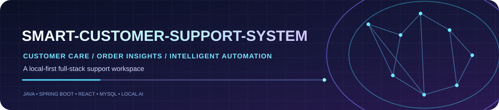
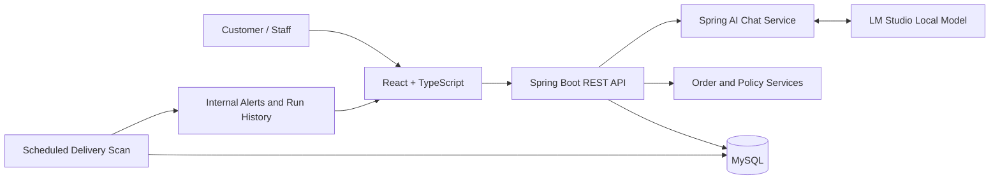

<div align="center">



# SMART-CUSTOMER-SUPPORT-SYSTEM

<p>


</p>

<strong>AI-assisted customer care · Order intelligence · Internal delivery automation</strong>

<p>Built with Java and Spring Boot, React, MySQL, and a locally hosted language model.</p>

</div>

## 🎬 Animated project walkthrough

The looping walkthrough below cycles through all five pages from the website recording: Overview, AI Support, Orders, Policies, and Automation. Each view is displayed for about five seconds.

<p align="center">
  
</p>

<p align="center"><em>Overview → AI Support → Orders → Policies → Automation · Repeats continuously</em></p>

---

## Overview

**SMART-CUSTOMER-SUPPORT-SYSTEM** is a full-stack customer-support demo built with a Java/Spring Boot REST API and a React interface. It connects a locally hosted language model through LM Studio with MySQL-backed order data, policy guidance, and scheduled overdue-delivery checks.

> This is a local learning and portfolio project. Orders and policy data are demo data. It does not connect to a real store or submit real return/refund requests.

## Features

| Area | What it does |
|---|---|
| 💬 **AI Support** | Chat UI backed by Spring AI and an OpenAI-compatible local LM Studio endpoint. Order lookup tools ground answers in demo data. Common return-policy questions have deterministic handling and empty model answers get a fallback. |
| 📦 **Order Management** | View/search demo orders, create or update order records, and work with order status, estimated delivery date, and total amount. |
| 📚 **Policies** | Dedicated return/refund policy guidance that explains the limitations of the demo data. |
| ⚙️ **Delivery Automation** | Periodically scans overdue orders that remain `PROCESSING` or `SHIPPED`, creates internal notifications, records run history, prevents duplicate alerts through service logic, and allows staff to manually run scans or acknowledge alerts. |

**Automation boundary:** The current automation creates internal alerts only. It does not send customer emails/SMS, issue refunds, approve returns, cancel orders, or change order status automatically.

## Technology stack and tools

| Area | Technology / tool | Purpose |
|---|---|---|
| Backend language | Java 21 | Business logic and REST API |
| Backend framework | Spring Boot 3.4.5 | Application and API runtime |
| AI integration | Spring AI 1.0.0 | Chat client and model integration |
| Local model server | LM Studio | Runs a local model with an OpenAI-compatible API, default port `1234` |
| Persistence | Spring Data JPA, Hibernate | ORM and database access |
| Database | MySQL 8.x | Demo orders and automation records |
| Frontend | React 18, TypeScript 5.7 | User interface |
| Frontend tooling | Vite 6, npm | Development server and build |
| Icons | lucide-react | Interface icons |
| Build and tests | Maven, Spring Boot Test | Backend dependencies, build, and tests |
| Editor | VS Code or another Java IDE | Editing and debugging |
| Source control | Git and GitHub | Version control and repository hosting |

## Architecture



## Prerequisites

Install these before starting the project:

| Requirement | Recommended version/setup | Verify |
|---|---|---|
| Operating system | Windows 10/11, macOS, or Linux | — |
| Java JDK | **JDK 21** | `java -version` |
| Apache Maven | 3.9+ | `mvn -version` |
| Node.js and npm | Node.js LTS, Node 20+ recommended | `node -v` and `npm -v` |
| MySQL Server | MySQL 8.x | `mysql --version` |
| LM Studio | Desktop app for your OS | Open LM Studio |
| Local instruct/chat model | Choose a model your laptop can run; this project was developed with a small Qwen instruct model | Load model and start server |
| Git | Optional, for cloning/updating | `git --version` |

**Low-RAM note:** Prefer a small quantized model suited to your laptop. Model speed and compatibility depend on available memory and hardware. No paid OpenAI API key is required for the configured local LM Studio workflow.

## Installation

### 1. Download the project

```powershell
git clone https://github.com/SAI-SRINIVAS-P/SMART-CUSTOMER-SUPPORT-SYSTEM.git
cd SMART-CUSTOMER-SUPPORT-SYSTEM
```

Or on GitHub select **Code → Download ZIP**, then extract the archive.

### 2. Create the MySQL database and user

Open MySQL Workbench or sign in to the MySQL command-line client as an administrator and execute:

```sql
CREATE DATABASE IF NOT EXISTS smartsupport;

CREATE USER IF NOT EXISTS 'smartsupport'@'localhost'
  IDENTIFIED BY 'replace-with-a-strong-local-password';

GRANT ALL PRIVILEGES ON smartsupport.* TO 'smartsupport'@'localhost';
FLUSH PRIVILEGES;
```

If the user already exists, use `ALTER USER` to set its password. Keep real passwords local; never commit them to GitHub. The backend's default username is `smartsupport`, and its default password is only a placeholder.

### 3. Configure environment variables (PowerShell)

Set these in the same PowerShell window from which you start the backend:

```powershell
$env:DB_USERNAME = "smartsupport"
$env:DB_PASSWORD = "replace-with-a-strong-local-password"
$env:LM_STUDIO_BASE_URL = "http://localhost:1234/v1"
$env:LM_STUDIO_API_KEY = "lm-studio"
$env:LM_STUDIO_MODEL = "local-model"
```

If chat requests fail, set `LM_STUDIO_MODEL` to the model identifier exposed by your LM Studio server. The API key value shown here is a local placeholder, not a real OpenAI API key.

### 4. Start the local model server

1. Open LM Studio and download a model supported by your laptop.
2. Load the model.
3. Open its **Developer / Local Server** section (the label may vary by LM Studio version).
4. Start the OpenAI-compatible server at `http://localhost:1234`.
5. Keep LM Studio running while testing AI chat.

## Run locally

Use **two terminal windows** from the project root.

### Terminal 1: Start the backend

```powershell
cd backend
mvn test
mvn spring-boot:run
```

Backend base URL: **http://localhost:8080**

Useful local endpoints:
- Health: `http://localhost:8080/api/health`
- Orders: `http://localhost:8080/api/orders`
- Policy: `http://localhost:8080/api/policy`

The development configuration uses Hibernate's `ddl-auto: update` to create/update tables. The demo seeder inserts sample orders only when the orders table is empty.

### Terminal 2: Start the frontend

```powershell
cd frontend
npm install
npm run dev
```

Open the Vite URL printed in the terminal, usually **http://localhost:5173**.

To build the frontend:

```powershell
npm run build
```

### Smoke-test the application

1. Open **Overview** and confirm the backend indicator shows online.
2. In **AI Support**, ask `Where is order ORD-1001?` and `What is your return policy?`.
3. In **Orders**, search for `ORD-1001`.
4. In **Automation**, click **Run check now**.
5. To test an overdue alert, set an order's estimated delivery date to yesterday and keep its status as `SHIPPED` or `PROCESSING`. Run a scan, verify the alert, run the scan again to check for duplicates, then restore the date.

## Troubleshooting

<details>
<summary><strong>Backend cannot connect to MySQL</strong></summary>

- Confirm the MySQL service is running.
- Confirm the `smartsupport` database exists.
- Set `DB_USERNAME` and `DB_PASSWORD` in the same terminal used to run Maven.
- Check that the JDBC URL in `backend/src/main/resources/application.yml` points to `localhost:3306`.
- Restart Spring Boot after changing environment variables.
</details>

<details>
<summary><strong>MySQL reports “Access denied for user 'smartsupport'@'localhost'”</strong></summary>

The password or permissions do not match. Sign in as a MySQL administrator and run:

```sql
ALTER USER 'smartsupport'@'localhost'
  IDENTIFIED BY 'replace-with-a-strong-local-password';
GRANT ALL PRIVILEGES ON smartsupport.* TO 'smartsupport'@'localhost';
FLUSH PRIVILEGES;
```

Set `$env:DB_PASSWORD` to the same password and restart Spring Boot.
</details>

<details>
<summary><strong>MySQL reports “Table 'smartsupport.orders' doesn't exist” or a table-creation permission error</strong></summary>

- Check the first database error in the backend console.
- Confirm the application user has privileges on the `smartsupport` schema, including table creation for this development setup.
- A database administrator can grant schema privileges using the SQL above.
- Restart the backend after the permissions are fixed; Hibernate should create/update tables with `ddl-auto: update`.
</details>

<details>
<summary><strong>“mvn” or “npm” is not recognized</strong></summary>

Install JDK 21 and Maven, plus Node.js LTS (which includes npm). Close and reopen PowerShell, then verify with `java -version`, `mvn -version`, `node -v`, and `npm -v`.
</details>

<details>
<summary><strong>Frontend says the backend is offline or API requests fail</strong></summary>

- Confirm the backend has started successfully on port 8080.
- Check the backend terminal for startup errors.
- Check the browser developer tools Network tab for failed `/api` requests.
- The frontend currently uses `http://localhost:8080/api` in `frontend/src/App.tsx`; update it if you configure a different backend port.
</details>

<details>
<summary><strong>AI chat returns an empty/generic response or cannot reach LM Studio</strong></summary>

- Confirm the model is loaded in LM Studio and the local server is started on port 1234.
- Check `LM_STUDIO_BASE_URL` and `LM_STUDIO_MODEL`.
- Test with a simple question such as `Where is order ORD-1001?`.
- Smaller models may struggle with complex prompts. Return-policy questions have a deterministic backend path, while general responses still rely on the local model.
</details>

<details>
<summary><strong>Automation page says the API is unavailable</strong></summary>

- Confirm this repository's automation backend classes are present.
- Restart the backend and wait for successful startup.
- Inspect the browser Network tab for `/api/automation/...` errors.
- Verify the database is reachable.
</details>

<details>
<summary><strong>Port 8080 or 5173 is already in use</strong></summary>

Stop the other application using the port or select a different port. If the backend port changes, update the API base URL in `frontend/src/App.tsx`.
</details>

If the problem continues, copy the **first meaningful error and its “Caused by” section** from the backend terminal when opening an issue. Never post real passwords, API keys, or other secrets.

## Configuration reference

| Variable | Default | Meaning |
|---|---|---|
| `DB_USERNAME` | `smartsupport` | MySQL application user |
| `DB_PASSWORD` | `change-this-password` | Placeholder database password; set your own locally |
| `LM_STUDIO_BASE_URL` | `http://localhost:1234/v1` | Local model API base |
| `LM_STUDIO_API_KEY` | `lm-studio` | Local placeholder value |
| `LM_STUDIO_MODEL` | `local-model` | Model identifier sent by Spring AI |
| `AUTOMATION_ENABLED` | `true` | Enable scheduled scans |
| `AUTOMATION_SCAN_INTERVAL_MS` | `300000` | Scan interval in milliseconds (5 minutes) |
| `AUTOMATION_INITIAL_DELAY_MS` | `30000` | Initial delay in milliseconds |

## Repository structure

```text
SMART-CUSTOMER-SUPPORT-SYSTEM/
├── backend/
│   ├── src/main/java/com/example/smartsupport/
│   │   ├── automation/     # Delivery scans, notifications, history
│   │   ├── chat/           # Chat, policy answers, model tools
│   │   ├── order/          # Order API and persistence
│   │   ├── seed/           # Demo orders
│   │   └── config/         # Web configuration
│   ├── src/main/resources/application.yml
│   └── pom.xml
├── frontend/
│   ├── src/App.tsx
│   ├── src/style.css
│   └── package.json
└── docs/
    ├── project-tour.gif
    └── screenshots/
```

## Scope and limitations

- This is a local portfolio/demo project, not a production-ready service.
- Demo orders are not synchronized with a live e-commerce platform.
- Return-policy answers are guidance only; requests are not submitted or approved and refunds are not issued.
- Delivery automation creates internal notifications only; customer email/SMS is not implemented.
- Before production use, add authentication and authorization, secure secret management, database migrations, deployment configuration, and monitoring.

## Contributing

Before submitting a change, run `mvn test` from `backend` and `npm run build` from `frontend`. Include clear reproduction steps when reporting a bug.

## License

See [LICENSE](LICENSE).

<div align="center">

**SMART-CUSTOMER-SUPPORT-SYSTEM** · Built for learning, experimentation, and portfolio demonstration.

</div>
